# maxi-bot

A private Telegram bot that translates and narrates documents at a quoted price, and keeps your notes and diary.

<table>
<tr>
<td align="center">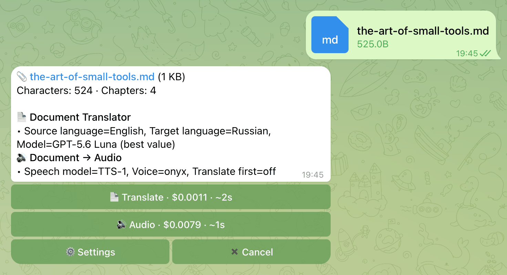</td>
<td align="center">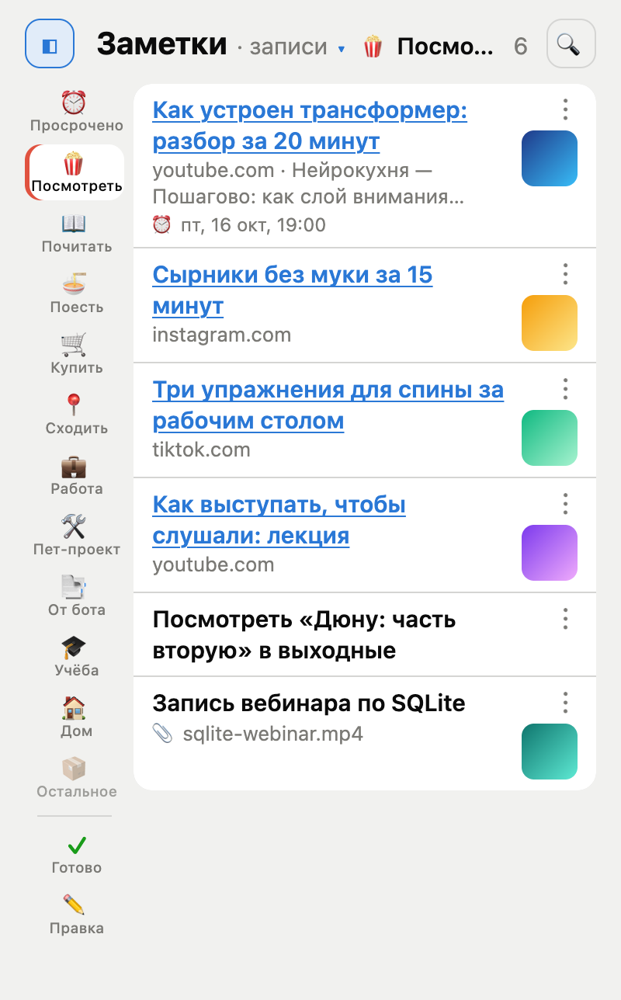</td>
<td align="center">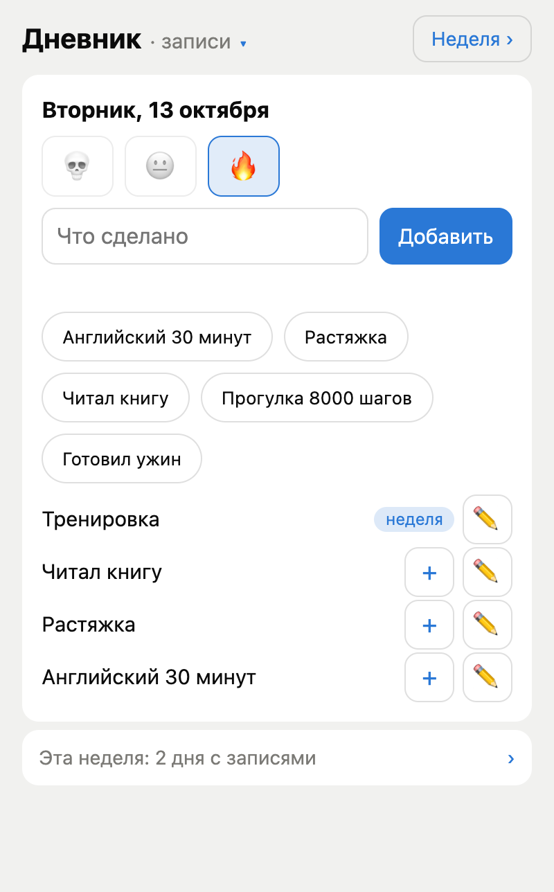</td>
</tr>
<tr>
<td align="center">A price before every run.</td>
<td align="center">Notes, filed into Sections.</td>
<td align="center">A diary of what got done.</td>
</tr>
</table>

Send the bot a document or a website link and it shows what each agent would cost before it spends anything. Send it anything else (a thought, a social link, a photo, a voice message) and it lands in your notes, filed and summarised. A Mini App inside Telegram browses the notes, keeps a diary and shows what the bot has cost you.

> [!NOTE]
> The bot serves one account, its **Owner**, and answers nobody else. There is no way to add users: to use it, run your own instance (ADR-022).

## What it does

### A price before every run

Send a `.pdf`, `.docx`, `.md`, `.markdown` or `.txt` file (up to 20 MB) or a single website link. The bot answers with a card: size, characters, chapters, and one button per agent with its price and time estimate (`📄 Translate · $<price> · ~<time>`), plus `⚙️ Settings` and `✖️ Cancel`. One tap runs it, with no confirm step. The card shows live progress, then the result arrives as a Markdown file or a voice message with its real cost in the caption. `💾 В заметки` under a result files it in the built-in Section «От бота».

<table>
<tr>
<td align="center">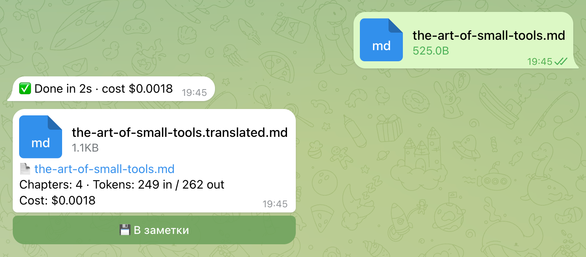</td>
<td align="center">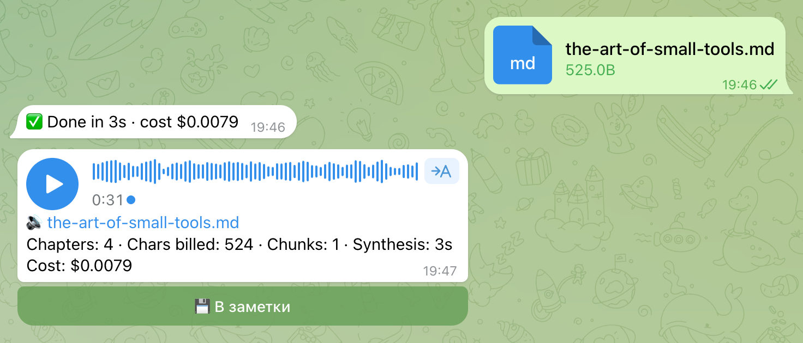</td>
</tr>
<tr>
<td align="center">📄 Translate: a Markdown file.</td>
<td align="center">🔊 Audio: a voice message.</td>
</tr>
</table>

- A job estimated above `BOT_MAX_JOB_COST_USD` (default $10) is refused, and a translation aborts if real spend passes three times its estimate. There is no daily cap.
- One job runs at a time, and at most 5 jobs are queued or running. `/status` lists them, `/cancel` drops the queued ones.
- A restart (every deploy) empties the card book: an old card answers "expired", and a job that was running is marked interrupted.

<details>
<summary>When a job fails, the bot says whose side broke</summary>

A failed job answers one question first: wait, or go fix something? Before it blames OpenAI, the bot checks with a free unbilled probe of the API and its status page.

| Badge | Meaning |
|---|---|
| 🟡 Their side (OpenAI) | 5xx, 429, timeout: clears itself |
| 🔴 Our side | a bad key, missing quota, a wrong model id, or a bug: check the logs |
| 🟠 This document | the file itself is the problem |

</details>

### Three agents

| Agent | In | Out | Button |
|---|---|---|---|
| `doc_translator` | a document or an article link | the translation as Markdown, chapter by chapter | `📄 Translate` |
| `pdf_tts` | the same | one voice message (Ogg/Opus), optionally translated first | `🔊 Audio` |
| `yt_dub` | one YouTube link | a voice-over in your language: captions first, speech-to-text when there are none | `🎬 Dub` |

- **Reaching `🎬 Dub`.** A bare YouTube, Instagram or TikTok link is saved to notes without a card. Put the link after a command to get the card instead: `/dub https://www.youtube.com/watch?v=...` (a bare `/dub` answers with that hint).
- **Settings.** `/settings` has `📄 Translator` (source language, target language, model) and `🔊 Audio` (speech model, voice, translate first, and `🔊 Test` to hear a voice). Defaults are English to Russian; the languages offered come from `BOT_LANGUAGES`.
- **Limits.** 20 MB in, 50 MB out (longer audio is split into parts of up to 48 MB), 2,000,000 characters a document, videos up to 4 hours. A video with no captions fails above roughly 65 minutes (the 25 MB speech-to-text cap). DOCX body paragraphs only; a PDF needs extractable text (no OCR).
- **Commands.** `/settings`, `/status`, `/cancel`, `/help` (the same as `/start`).

### Send anything, it lands in notes

Everything that is not a priced document or a single website link is saved at once. The bot's reply is a reaction on your message: ✍ working, 👌 saved, 👎 take a look. A reminder also gets one text reply, with its Due (see Reminders). That covers text, several links, social links, photos, videos, files, voice messages and round videos; a forwarded message keeps its sender. A website link gets the priced card, with `💾 В заметки` on top.

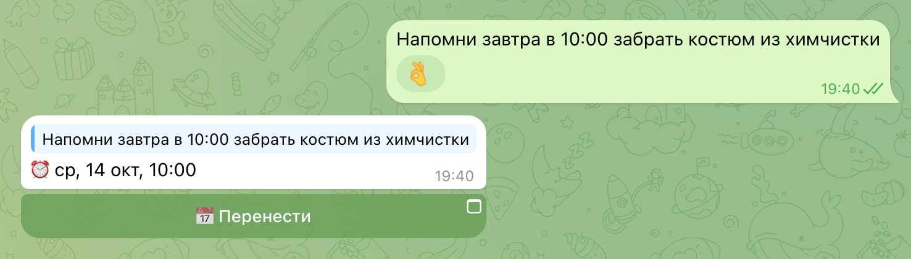

Behind the reaction (`apps/notes`, ADR-015), an Item is one of five kinds (link, note, file, voice, bot_result). The bot fetches a title, author and caption (YouTube, Instagram, TikTok or any web page), cuts a thumbnail, transcribes a voice message, and a classifier files the Item into one to three Sections and writes a short Russian summary, at about $0.002 an Item. The same link twice makes one Item, and a failed step is retried with backoff.

### Reminders

Say «напомни …» in a text or a voice message, and the bot replies with the Due, for example «⏰ пт, 10 окт, 19:00», and a «📅 Перенести» button that opens the Item in the Mini App. At the Due it writes back to your original message: «⏰ Напоминание» with «✅ Готово» and «📅 Перенести». An Item whose Due passed lands under «⏰ Просрочено».

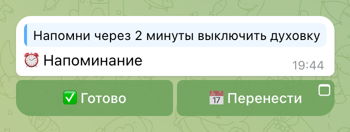

## The Mini App

One page inside Telegram, in Russian, for what the bot keeps: your notes, your diary and what the bot has cost you. It opens where you left it, paints from the last answers at once and refreshes in the background.

### Open it and move around


<table>
<tr>
<td valign="top">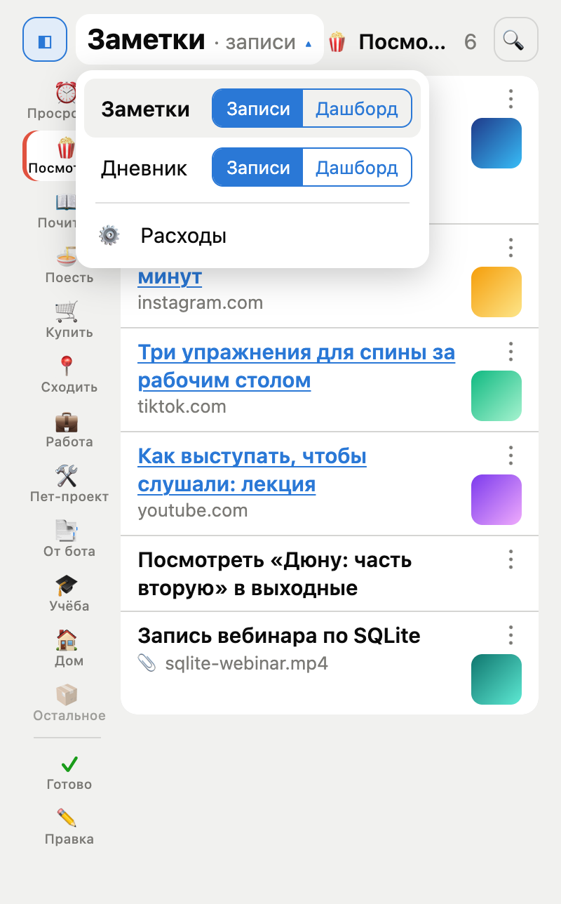</td>
<td valign="top">
<ul>
<li>The <code>📒</code> button on the left of the message field (the picture above) opens it.</li>
<li>Two chat buttons open it on a fixed screen: «📅 Перенести» on a reminder shows that Item, «✍️ Записать» on the diary's evening message shows today's Day.</li>
<li>The title row names where you are, for example <code>Заметки · записи ▾</code>. A tap opens the menu: a Place, «Заметки» or «Дневник», each as «Записи» (the working list) or «Дашборд» (the numbers), and «⚙️ Расходы» below.</li>
<li>A Place opens in the Mode you left it in. The Section you picked and the rail's state are remembered too.</li>
<li>Telegram's back button closes what opened over a list: an Item, a form.</li>
</ul>
</td>
</tr>
</table>

### Notes

The list shows one Section at a time, newest first, under a rail of Sections (`◧` hides it); «⏰ Просрочено», «✓ Готово» and «✏️ Правка» sit on the same rail.

<table>
<tr>
<td align="center"></td>
<td align="center">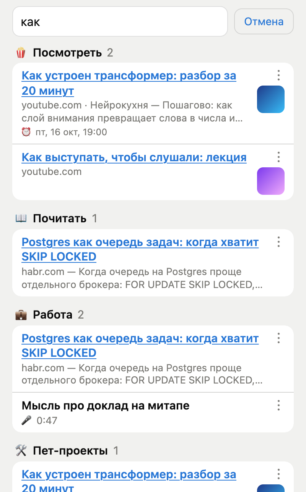</td>
<td align="center">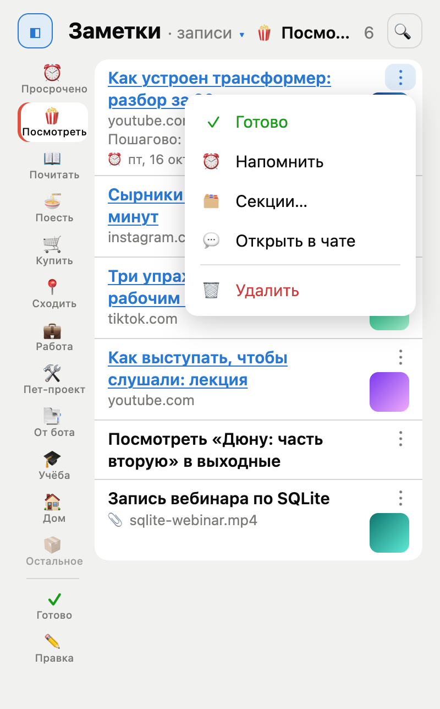</td>
</tr>
<tr>
<td align="center">A Section's Items, with the rail to switch.</td>
<td align="center">🔍 searches every Item, grouped by Section.</td>
<td align="center">Everything about a row is one tap away.</td>
</tr>
</table>

- A row has a «⋮» menu and swipes (done, with a four-second undo; a reminder), the «Готово» list holds what you finished, and «💬 Открыть в чате» makes the bot point at the original message.
- An Item opens on its own screen, and the dashboard counts what is waiting.

<table>
<tr>
<td align="center">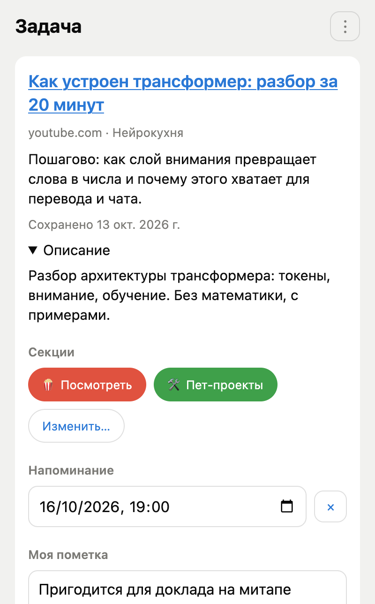</td>
<td align="center">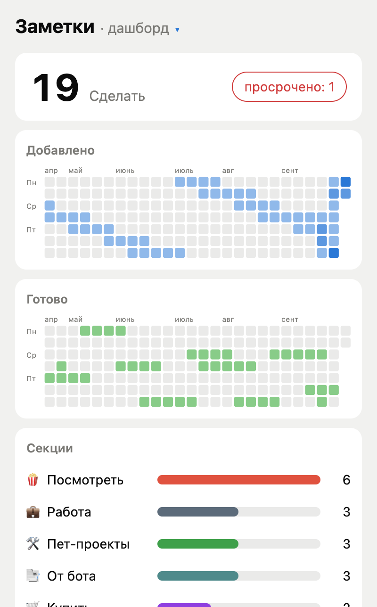</td>
</tr>
<tr>
<td align="center">One Item: Sections, reminder, text, fetched description.</td>
<td align="center">What is waiting, and how the last 26 weeks went.</td>
</tr>
</table>

Sections are yours to edit. «✏️ Правка» lists them: «+ Новая секция» adds one, drag «⋮⋮» to reorder, «✏️» opens one. A Section has a name, an emoji, a colour and a «Подсказка для разбора» that the classifier reads when it files. «Остальное» and «От бота» cannot be deleted; deleting another one moves the Items that were only there into «Остальное».

<table>
<tr>
<td align="center">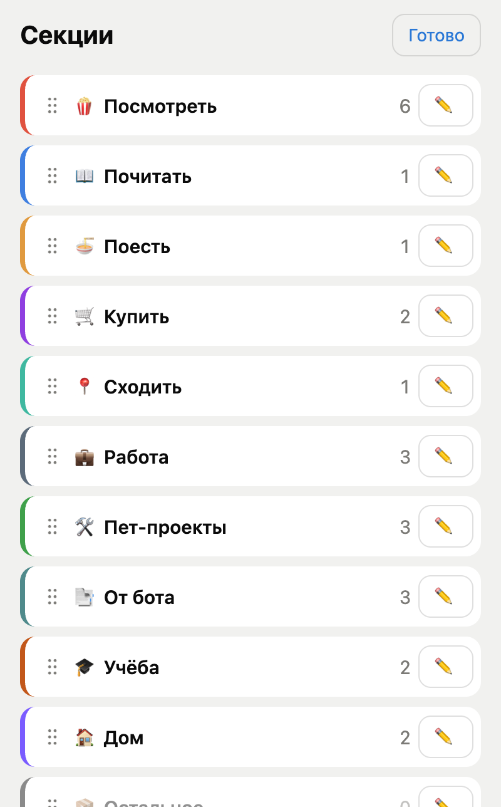</td>
<td align="center">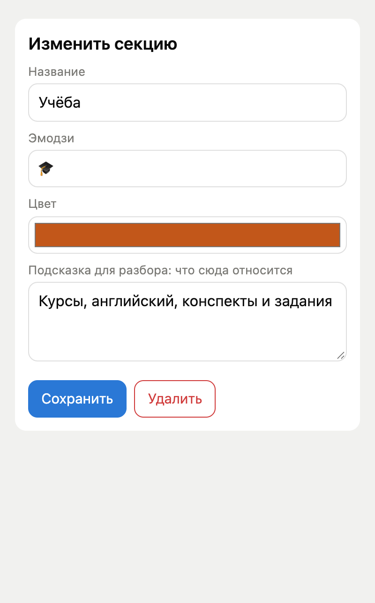</td>
</tr>
<tr>
<td align="center">Drag to reorder.</td>
<td align="center">A name, an emoji, a colour and a hint.</td>
</tr>
</table>

### Diary

The diary (`apps/diary`, ADR-020) is written only in the Mini App: short Entries (up to 120 characters) per Day, and one Mark for the Day, 💀 😐 🔥. Raise your best Entries (and lower them again) to put them into the summary of their Week, then of the Month and the Year.

<table>
<tr>
<td align="center">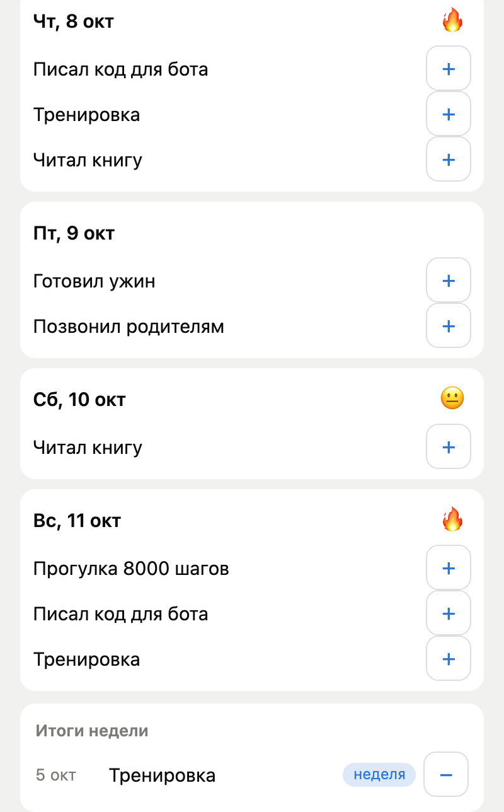</td>
<td align="center">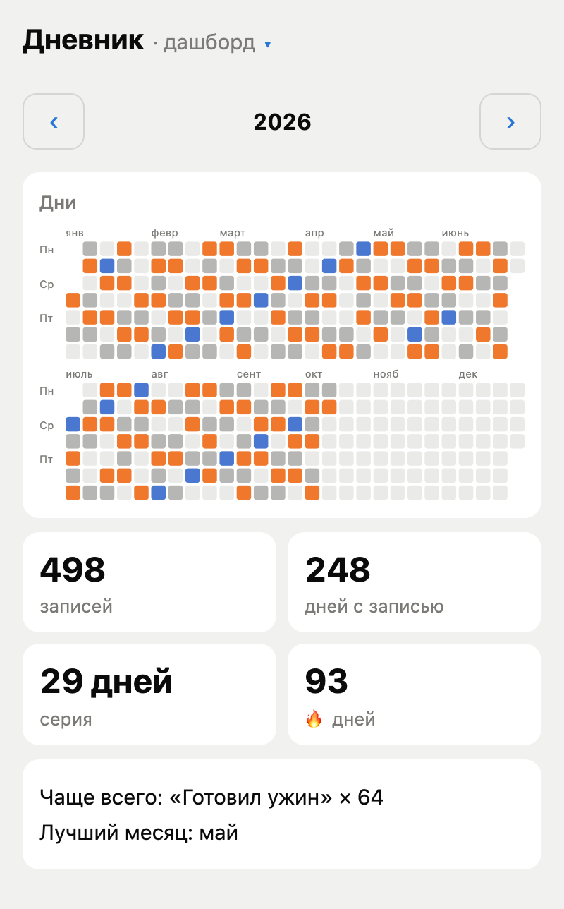</td>
</tr>
<tr>
<td align="center">The best entries are raised into the week's summary.</td>
<td align="center">A year at a glance, coloured by each Day's mark.</td>
</tr>
</table>

The dashboard keeps the streak and the best month. If a Day is still untouched at 22:00 in your time zone, the bot sends «📔 Сегодня в дневнике пусто» with a button to write, at most once a Day. That is all the diary does in chat.

### What it costs you

«⚙️ Расходы» shows the total spent over a 14-day sparkline and lists every job with its cost, its time and its details; a tap on «Ошибки» keeps the failed ones.

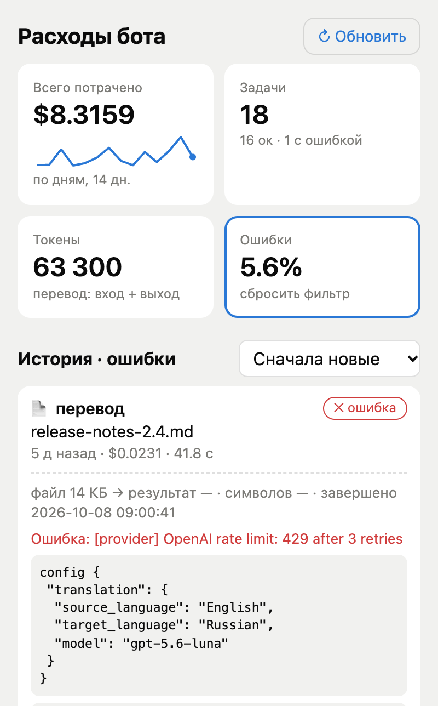

## Quick start

You need Python 3.12+, [uv](https://docs.astral.sh/uv/), an [OpenAI API key](https://platform.openai.com/api-keys) and, for the bot, a Telegram account.

> [!WARNING]
> Every run calls OpenAI and is billed to your key. The runner and the bot show a price first and ask before they spend.

```bash
git clone https://github.com/IAmDrozdov/maxi-bot.git && cd maxi-bot
uv sync --all-packages
cp .env.example .env            # fill OPENAI_API_KEY at minimum
uv run smoke doc_translator README.md
```

The runner prints a free preview and a price, asks before spending, and writes the result to `dist/smoke/`. Any workflow knob can be overridden with `--config`:

```bash
uv run smoke pdf_tts book.pdf --config '{"translation": {"target_language": "German"}}'
uv run smoke yt_dub https://www.youtube.com/watch?v=...
```

## Run the bot

1. Message [@BotFather](https://t.me/BotFather), send `/newbot`, put the token into `TELEGRAM_BOT_TOKEN`.
2. Message [@userinfobot](https://t.me/userinfobot) to get your numeric id, put it into `OWNER_TELEGRAM_ID`. That account is the Owner: the bot answers it and nobody else, and does not start without it.
3. `uv run telegram-bot`, open your bot in Telegram, press Start.

Details: `interfaces/telegram_bot/README.md`. The Mini App needs a public HTTPS URL: set up Tailscale Funnel as in `infrastructure/README.md`, then put the address in `BOT_MINIAPP_URL`. To look at the Mini App without Telegram, `uv run python tools/miniapp_local.py up` starts it on throwaway data and writes a signed local URL (`docs/verifying.md` §2); `up --demo` seeds the invented Russian data these pictures were taken from.

## Configuration

Everything an operator changes lives in `.env` (`.env.example` is the commented reference). Workflow behaviour knobs (chunk sizes, backstops, prompts) stay in code under `workflows/<name>/src/<name>/config.py` on purpose (ADR-004).

| Variable | Default | Meaning |
|---|---|---|
| `OPENAI_API_KEY` | none | required: every workflow and the notes classifier bill against it |
| `TELEGRAM_BOT_TOKEN` | none | required for the bot |
| `OWNER_TELEGRAM_ID` | none | required for the bot: the numeric id of the one account it answers |
| `BOT_MAX_JOB_COST_USD` | 10 | refuse a single job estimated above this |
| `BOT_MINIAPP_URL` | empty | public HTTPS URL of the Mini App; empty means no 📒 button, no «📅 Перенести» on reminders and no «✍️ Записать» on the diary Nudge |
| `NOTES_CLASSIFIER_PROVIDER` | `fake` in code, `openai` in `.env.example` | who files Items and writes the summary; `fake` is offline and files everything to «Остальное» |

<details>
<summary>Every variable in <code>.env.example</code></summary>

| Variable | Default | Meaning |
|---|---|---|
| `BOT_LANGUAGES` | English, Russian, Chinese, Japanese, Korean, French, German, Spanish | languages offered in `/settings` |
| `BOT_DEFAULT_SOURCE_LANGUAGE` / `BOT_DEFAULT_TARGET_LANGUAGE` | English / Russian | defaults until changed in `/settings` |
| `YTDLP_PROXY` | none | optional proxy for YouTube requests, e.g. the bundled WARP sidecar (ADR-014) |
| `WARP_ACCEPT_TOS` | none | `yes` starts the WARP sidecar on deploy; you accept Cloudflare's terms |
| `TELEGRAM_DB_PATH` | `data/telegram_bot.sqlite3` | settings and usage log |
| `NOTES_DB_PATH` | `data/notes.sqlite3` | the notes database |
| `DIARY_DB_PATH` | `data/diary.sqlite3` | the diary database |
| `NOTES_CLASSIFIER_MODEL` | empty | empty means the default translation model from `shared/pricing.py` |
| `NOTES_ENRICH_SWEEP_SECONDS` | 60 | how often failed or interrupted enrichment is retried |
| `TS_AUTHKEY` | none | Tailscale auth key: deploy starts the Funnel sidecar that publishes the Mini App (ADR-016) |
| `LOG_LEVEL` | `INFO` | |
| `OTEL_*` | off | optional tracing, see `docs/observability/tracing-elk.md` |
| `DO_API_KEY` | none | Terraform and the SSH gate only, never read by app code |

</details>

Models, prices and voices are one catalogue in `shared/src/shared/pricing.py`. Prices are estimates; check your OpenAI invoice.

## Security

- The bot answers one account, the Owner (`OWNER_TELEGRAM_ID`), in a private chat. Every other update is dropped without a reply (ADR-022).
- The Mini App is public over HTTPS (Tailscale Funnel), but every API call needs Telegram-signed data from the Owner: HMAC-checked, at most 24 h old, the Owner's id only (ADR-016). Its container holds a key derived from the bot token, never the token.
- Link enrichment for notes fetches pages from the bot process through an SSRF guard (public addresses only, every redirect re-checked).
- In production every container runs read-only with all capabilities dropped and memory and pid caps (the bot and the Mini App also run non-root), and the droplet accepts no inbound connections: SSH is opened for the operator's address only for the length of one gated command, such as a deploy, a Backup run or a `droplet.sh` call (ADR-017, `infrastructure/README.md`).
- A secrets scan (trufflehog) runs on every commit, push and deploy, and a deploy stops on a High dependency vulnerability (grype).
- Untrusted documents are parsed inside the bot process; the caps above are the blast radius.

## Data and privacy

- Three sqlite databases: the bot's (settings and usage log), `notes.sqlite3` and `diary.sqlite3`.
- Document text, transcripts and pasted-link content are sent to OpenAI to translate, transcribe or synthesize. An agent run stores no document text, transcript or audio; its log row, kept indefinitely, keeps your Telegram id and username, the file name, cost and error text, and is what «Расходы» shows.
- Notes keeps every captured text and link, its fetched title, author, caption and thumbnail, a voice message's Transcript, and a reference to each BotResult, until you delete it in the Mini App. A note's text goes to the classifier and a voice message to speech-to-text, both OpenAI. The bytes of a File or a Voice stay in Telegram (the Item keeps a `file_id`) and, up to the 20 MB Bot API download cap, in the Backup.
- The diary is stored only in `diary.sqlite3`; none of it is sent to OpenAI.

## Legal note

`yt_dub` reads captions when a video has them. When it has none, it downloads the audio track for transcription, which is against YouTube's Terms of Service. Running that fallback is your decision and your risk (ADR-010).

## Deploy and operate

`infrastructure/` provisions one DigitalOcean droplet with Terraform and deploys the bot and the Mini App with Docker Compose. Full guide: `infrastructure/README.md`.

- `./infrastructure/deploy.sh` scans for secrets and vulnerabilities, rsyncs the repo, builds the image on the droplet and waits until it is healthy. AI-agent users can run the `/deploy-bot` skill.
- Port 22 is closed by default; `infrastructure/ssh-gate.sh` opens it for your address for one command (ADR-017).
- `infrastructure/droplet.sh status | logs | sql | py` inspects production in one gated call each.
- A daily **Backup** is pulled to the Owner's Mac, verified on arrival, 30 days kept (ADR-018); restore and rollback are in the guide.

## Project layout

<details>
<summary>Folders</summary>

- `shared/`: settings, logging, the job contract, pricing, document intake, translate, speech and speech-to-text stages
- `workflows/<name>/`: workflow business logic (graph and nodes) and its job descriptor (`runtime.py`)
- `apps/notes/`, `apps/diary/`: the stateful apps, each with its own database and rules
- `interfaces/telegram_bot/`: the Telegram bot and the Mini App
- `interfaces/smoke/`: a terminal runner over the same job contract
- `infrastructure/`: Terraform and Docker deployment to a DigitalOcean droplet
- `docs/`: architecture, conventions, ADRs; `docs/images/readme/` holds the pictures above
- `.skills/`, `.claude/skills/`: instructions for AI agents (scaffolding, deploy, live test, README refresh)
- `tools/`: `check_layers.py` enforces the layer rules, `miniapp_local.py` runs the Mini App on throwaway data, `observability/` is a local ELK + APM stack

</details>

## Docs

- [Architecture](docs/architecture.md), [Conventions](docs/conventions.md), [Tooling](docs/tooling.md), [Runtime](docs/runtime.md) (what runs and how the parts talk), [Verifying](docs/verifying.md)
- [Decisions (ADRs)](docs/decisions/) are binding
- [Workflows index](docs/workflows-index.md), [Glossary](CONTEXT.md)
- Parts: [Telegram bot](interfaces/telegram_bot/README.md), [notes](apps/notes/README.md), [diary](apps/diary/README.md), [infrastructure](infrastructure/README.md)
- Tracing is wired but off by default and creates no spans of its own yet: `docs/observability/tracing-elk.md`

## Contributing

See [CONTRIBUTING.md](CONTRIBUTING.md). There are no automated tests (ADR-001): changes are proven with the ladder in [docs/verifying.md](docs/verifying.md). AI agents working in this repo start at `AGENTS.md`.

## License

MIT, see [LICENSE](LICENSE).
